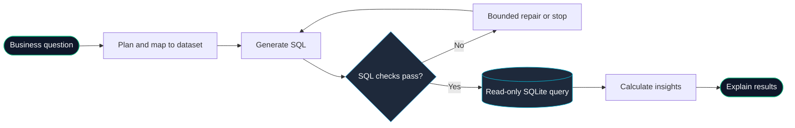

<div align="center">

# 📊 Text-to-SQL AI Data Analyst

[](https://www.python.org/)
[](https://fastapi.tiangolo.com/)
[](https://streamlit.io/)
[](https://langchain-ai.github.io/langgraph/)
[](.github/workflows/ci.yml)
[](LICENSE)

<p align="center">
  Ask questions about a CSV in plain English. The agent plans a query, checks its SQL, runs it read-only, and explains the result using calculated data.
</p>

**[🚀 Open the demo](https://genaidataanalystagent.streamlit.app/)** &nbsp;·&nbsp; **[📘 API docs (local)](http://localhost:8000/docs)** &nbsp;·&nbsp; **[☁️ Deployment guide](docs/deployment_guide.md)**

</div>

> [!TIP]
> For a quick demo, choose **Shared Demo Mode**, upload [`telco_churn_data.csv`](backend/eval/fixtures/telco_churn_data.csv), and ask: **“What is the average monthly charge by contract?”** The shared demo uses a common identity; use synthetic or public data only. The hosted Streamlit app also requires a reachable backend configured through `BACKEND_URL`.

---

## 🔄 How it works



The workflow is implemented with **LangGraph** and served through **FastAPI**, with a **Streamlit** interface. SQL is checked with `sqlglot` before execution. Queries use a read-only SQLite connection, a 10-second deadline, and a 1,000-row cap. When a query fails due to a schema or runtime error, the agent can attempt up to two repairs. Numerical insights are calculated from query results before the narrative is generated.

---

## 🎯 What I focused on

| Focus Area | Implementation |
| :--- | :--- |
| 🛡️ **Safe text-to-SQL** | Validate generated SQL before execution; block write operations, multiple statements, restricted system tables, and unrestricted `SELECT *` queries. |
| 🔐 **Scoped access** | Issue HS256 JWTs from server-configured accounts and associate uploaded datasets with the verified principal. A shared demo mode is available for public demonstrations. |
| 📡 **Traceable agent runs** | Langfuse records the agent turn and workflow stages, including status, latency, model, and available token usage. Query text, generated SQL, and result rows are not attached to observations. |
| 💰 **Measured cost estimate** | The app estimates cost from provider-reported token usage and explicit model rates in [`backend/app/core/telemetry.py`](backend/app/core/telemetry.py). This estimate is separate from Langfuse and is not a provider invoice. |

---

## 📊 Evaluation

The repository includes automated tests and deterministic evaluation replays for SQL behavior, security checks, ambiguity handling, and repair cases.

| Evidence | Result | How to interpret it |
| :--- | :---: | :--- |
| **Historical live 40-question run** | `38/40` | Earlier live result; not a current model-quality guarantee. |
| **Corrected deterministic 40-case replay** | `40/40` | Replays recorded SQL against local fixtures and corrected expectations; it does not call the model. |
| **Separate 20-case fixture replay** | `20/20` | Checks fixture and SQL contracts; it is not a blind or representative live-model evaluation. |
| **Live telemetry run** | `40/40 completed` | One run on a synthetic Telco fixture; observed mean 3,065.15 provider-reported tokens and estimated cost of $0.00053605 per query. |

> [!NOTE]
> The 40- and 20-case suites use synthetic fixtures. Their replay scores demonstrate those cases and application contracts, not broad real-world accuracy or independent generalization. The live telemetry figures are one observed run, not a latency or cost guarantee. See the [evaluation report](backend/eval/eval_report.md) and [failure analysis](specs/failure_analysis.md) for methodology, per-stage latency, and detailed findings.

---

## 🚀 Run locally

### 1. Requirements

- **Python 3.11+**
- A **[Groq API key](https://console.groq.com/)**
- A **[Langfuse Cloud](https://cloud.langfuse.com/)** project and API keys (required by the backend)

### 2. Configure and start the backend

```bash
git clone https://github.com/omrohitchannoji/GenAI_Data_Analyst_Agent.git
cd GenAI_Data_Analyst_Agent
cp backend/.env.example backend/.env
```

On Windows PowerShell, use `Copy-Item backend\.env.example backend\.env` instead. Edit `backend/.env` and set:

```env
GROQ_API_KEY=your_groq_api_key
GROQ_MODEL=openai/gpt-oss-120b
LANGFUSE_ENABLED=true
LANGFUSE_PUBLIC_KEY=your_langfuse_public_key
LANGFUSE_SECRET_KEY=your_langfuse_secret_key
LANGFUSE_HOST=https://cloud.langfuse.com
AUTH_SECRET_KEY=your_random_secret_at_least_32_bytes
```

Keep `.env` out of version control. Add `AUTH_USERS_JSON` if you want to enable configured username/password login; leave demo access enabled only for synthetic or public data.

```bash
cd backend
python -m venv venv
# Windows PowerShell: .\venv\Scripts\Activate.ps1
# macOS/Linux: source venv/bin/activate
pip install -r requirements.txt
uvicorn app.main:app --host 0.0.0.0 --port 8000 --reload
```

### 3. Start the frontend

In a second terminal:

```bash
cd frontend
pip install -r requirements.txt
streamlit run app.py --server.port 8501
```

Open [http://localhost:8501](http://localhost:8501). The backend API docs are at [http://localhost:8000/docs](http://localhost:8000/docs). Docker Compose is also available with `docker compose up --build`; it reads backend settings from `backend/.env`.

---

## 🧪 Tests and evaluation commands

GitHub Actions runs the offline test suite and deterministic fixture replays. To run them locally:

```bash
pytest backend/tests/ -v -rs
python backend/eval/eval_suite.py --replay
python backend/eval/eval_suite.py --held-out-replay
```

To collect live per-stage telemetry, which uses provider quota:

```bash
python backend/eval/latency_report.py --split development --limit 1 --live
```

---

## ⚠️ Limitations

> [!IMPORTANT]
> - Evaluation uses synthetic Telco data and fixture replays; it does not establish performance on arbitrary customer datasets.
> - Live model output, latency, and provider cost vary with the model, prompt, provider limits, and current pricing.
> - Shared Demo Mode uses a common identity. Do not upload private or sensitive data to it.
> - Langfuse credentials must be configured anywhere the backend runs. Backend startup fails when required Langfuse settings are missing or tracing is disabled.

---

## 📁 Project structure

```text
backend/app/          FastAPI service, LangGraph workflow, SQL checks, telemetry
backend/eval/         Synthetic fixtures, evaluation suites, latency report
backend/tests/        Unit and regression tests
frontend/             Streamlit interface
docs/                 Deployment guide and detailed project documentation
specs/                Failure analysis and benchmark notes
```

---

## 📄 License

MIT. See [LICENSE](LICENSE).
